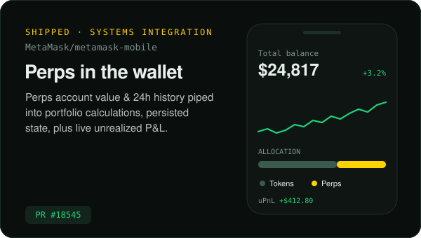
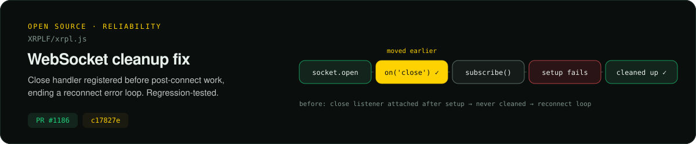

  

  
  
  

---

### ⚡ Selected work

I helped build **MetaMask Perps** (perpetual futures trading inside MetaMask Mobile, on Hyperliquid) across the stack, from controller and data layer to the screens traders use.

> **The problem:** MetaMask Mobile ties TP/SL to a position, but Hyperliquid's order book treats them as separate orders. Once a user added to a position or stacked multiple TP/SL sets, the app couldn't work out which ones applied, so they showed as **“Not set.”**
>
> **The fix (Solution B):** TP/SL orders bound to the position that **resize automatically** with it. Users can manage TP/SL from the position page even when several orders exist, and never have to re-size them by hand.
>
> [`893b916`](https://github.com/MetaMask/metamask-mobile/commit/893b9166ed2f144ab9c70d9354755246d9afdbad) · [PR #19726](https://github.com/MetaMask/metamask-mobile/pull/19726) · Sep 15, 2025

<table>
<tr>
<td width="50%" valign="top">

</td>
<td width="50%" valign="top">

</td>
</tr>
</table>

<b>📜 The details</b>

 

| Repo | Change | Why it mattered |
|---|---|---|
| `MetaMask/metamask-mobile` | [Position-bound TP/SL (#19726)](https://github.com/MetaMask/metamask-mobile/pull/19726) | Diagnosed a release-risking mismatch between MetaMask's position-based UI and Hyperliquid's separate orders, then proposed and shipped the fix the team adopted |
| `MetaMask/metamask-mobile` | [Perps transaction history (#17688)](https://github.com/MetaMask/metamask-mobile/pull/17688) | End-to-end feature: Fills, Orders and Funding history with provider and controller data fetching, lists, detail screens, fee breakdowns and explorer links |
| `MetaMask/metamask-mobile` | [Perps balance + P&L (#18545)](https://github.com/MetaMask/metamask-mobile/pull/18545) | Wired Perps account value and 24h history into portfolio calculations with persisted Redux state, and added unrealized P&L to the Perps tab |
| `XRPLF/xrpl.js` | [Socket close-handler fix (#1186)](https://github.com/XRPLF/xrpl.js/pull/1186) · [`c17827e`](https://github.com/XRPLF/xrpl.js/commit/c17827e030fec150bff22035cfccf8b38315c820) | Registered the close listener before post-connect work, ending a reconnect error loop in a widely used SDK, with a regression test for failed setup |

---

### 🛠️ What I'm building

<table>
<tr>
<td width="50%" valign="top">

#### [Metatron Automata](https://metatron.sh)
An AI-driven, multi-tenant trading platform, built as a composition engine for timestamped event streams. Trading is the first vertical.

`cell-based multi-tenancy` `venue adapters` `non-custodial delegated signing` `fill-to-settle state machines`

</td>
<td width="50%" valign="top">

#### [Embend](https://embend.com)
Finance compliance as an always-on monitoring agent that runs inside the customer's own systems, rather than another app to sign up for and connect.

`compliance` `AI agents` `deep integration`

</td>
</tr>
</table>

---

### 🧭 Where I've shipped

---

### 🧰 Toolbox

  
  
  
  
  
  
  
  

---

### 🤝 Let's talk

- 👯 **Collaborate with me on** trading automation
- 🤔 **Looking for help with** ML
- 💬 **Ask me about** parenting
- 📫 **Reach me at** [nickewansmith@gmail.com](mailto:nickewansmith@gmail.com)
- 😄 **Pronouns:** he/him
- 🇯🇲 **Fun fact:** Jamaican roots

  

